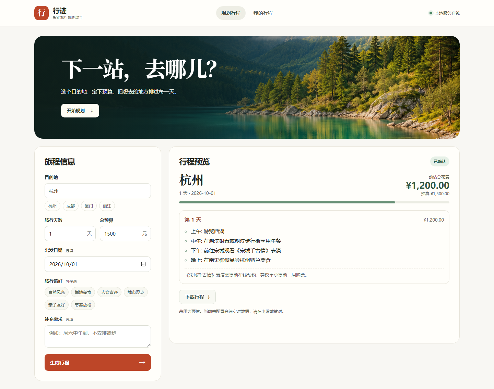
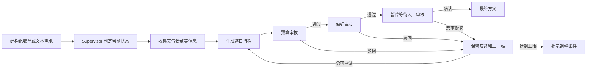

# 行迹 · 智能旅行规划助手

[]()
[]()
[]()

旅行计划从填写目的地、天数和预算开始。系统生成逐日行程和预估费用，用户可以确认，或提交具体修改意见后重新规划。确认的方案可以下载为 Markdown，也能从浏览器的“我的行程”重新打开。



**技术栈**　Python 3.13 · FastAPI · LangGraph · Pydantic · SQLite · Ollama

## 本地启动

启动后打开 [旅行规划页面](http://127.0.0.1:8000/) 即可体验。独立部署时，电脑需安装 uv 与 Ollama，并启动 Ollama 服务；模型由 Ollama 单独下载。

```powershell
ollama pull qwen2.5:7b
```

在 Windows 双击 `start-local.cmd`。它会在首次启动时复制本地模型配置、按锁文件安装 Python 依赖，然后在本机启动服务。已有的 `.env` 会保留。项目默认使用端口 8000，交互接口文档在 [Swagger UI](http://127.0.0.1:8000/docs)。

也可以在本项目目录逐步运行以下命令，已有 `.env` 时跳过复制。

```powershell
uv sync --locked --python 3.13
Copy-Item .env.local.example .env
uv run --locked python -X utf8 -m uvicorn local_entry:api --host 127.0.0.1 --port 8000 --env-file .env
```

本地配置通过 Ollama 的 OpenAI 兼容接口连接 Qwen2.5 7B，使用演示用 API Key。高德与 Tavily 凭证可按 `.env.example` 配置；本地示例未启用实时地图和搜索，行程费用为估算。示例中的 `API_KEY` 仅用于本地演示，部署到公网前请替换。

## 三分钟演示

1. 点击“杭州”填入一日游示例，预算 1500 元。出发日期可留空，表单会按原值传入工作流。
2. 生成后查看每一天的活动、预估花费和预算占比。选择“要求修改”，给出一条明确意见，例如“将下午的一项活动改为参观胡雪岩故居”。
3. 检查新方案并点击“确认行程”。下载 Markdown，再刷新页面或从“我的行程”恢复已确认方案。

浏览器保存最近打开的会话索引。行程及审核检查点保存在服务端 SQLite，按同一个 `thread_id` 加载。

## 工作流



表单字段由 Pydantic 校验并直接写入状态。文本接口保留需求提取，缺目的地或天数时返回补充提示。预算与偏好审核失败或人工要求修改时，工作流保留旧方案和反馈，重置审核状态再生成。SQLite 检查点配合 LangGraph 的 `interrupt()` 与 `Command(resume=...)` 保存并恢复人工审核。

## 项目文件

| 入口 | 用途 |
| --- | --- |
| `local_entry.py`、`static/` | 同源网页、结构化会话读取、行程展示与下载 |
| `app/main.py`、`app/config.py`、`app/models/` | FastAPI 接口、配置与输入输出校验 |
| `app/graph/`、`app/agents/` | Supervisor、状态定义、专职节点、重规划策略 |
| `app/db/` | 业务会话、计划记录与 SQLite 配置 |
| `app/tools/` | 高德、Tavily 适配与 TTL 缓存 |
| [`examples/chainlit/`](examples/chainlit/) | 可选对话演示及其独立配置 |
| `docs/` | 项目截图 |
| `tests/` | 路由、节点与工作流测试；`tests/evaluation/` 为需求提取评测资料 |

常用接口包括 `POST /plan`、`POST /resume`、`GET /planner/sessions/{thread_id}` 和 `GET /metrics`。

### 可选对话演示

先按上面的步骤启动旅行规划服务，再从项目根目录运行以下命令。打开 [对话界面](http://127.0.0.1:8002/) 即可体验。

```powershell
uv --directory examples/chainlit run --locked chainlit run chainlit_app.py --host 127.0.0.1 --port 8002
```

## 验证

```powershell
uv run --locked pytest -q
```

测试默认离线运行：不调用真实大模型、不访问外网（`tests/conftest.py` 内置外网熔断），干净检出后无需 `.env` 即可执行。本机结果为 22 passed / 4 skipped；4 项真实 API 集成用例默认跳过，设置 `RUN_INTEGRATION_TESTS=1` 后可显式运行。

本地测试覆盖缺字段退出、连续超预算达到上限以及人工审核的检查点恢复。

### 需求提取评测（历史基线）

`tests/evaluation/` 保留 50 条需求提取样本、旧/新两版评测脚本与历史报告：结构化输出合规率 50/50，用户提及字段中的目的地提取 41/42，偏好元素级 micro-F1 86.2%，样本级全对 43/50。该结果来自单次运行、受模型采样影响，仅作提示词迭代的对照基线，明细见 [评测说明](tests/evaluation/README.md) 与 `eval_report_20261014.txt`。

## 变更记录

版本演进、评测口径调整与已知限制见 [CHANGELOG.md](CHANGELOG.md)。

